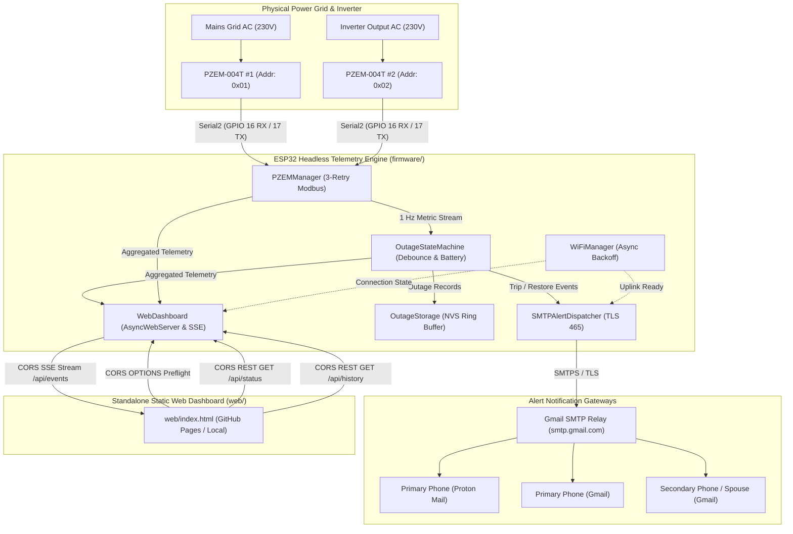
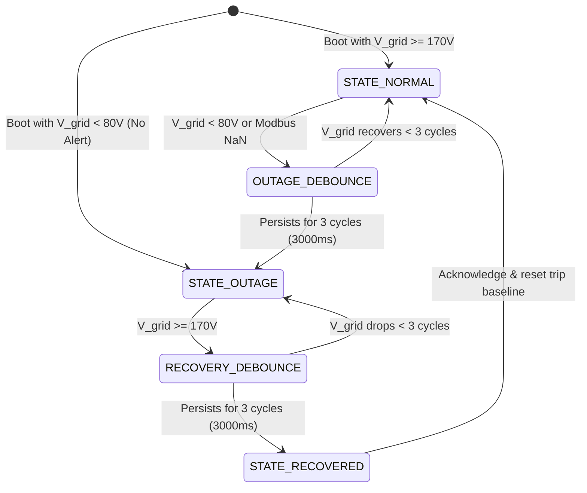
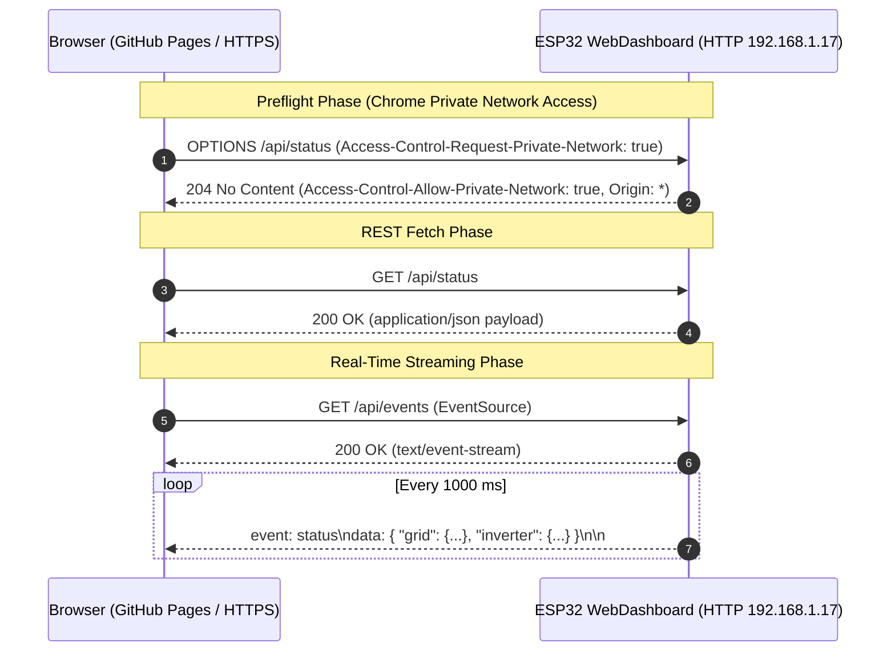

# VoltWatch System Architecture

This document details the software architecture, design patterns, component interactions, and execution lifecycle for the **VoltWatch** monorepo platform.

---

## 1. System Overview

VoltWatch is structured as a decoupled two-service monorepo:
1. **Embedded Headless Telemetry Engine (`firmware/`)**: A high-efficiency, non-blocking C++17 service running on the ESP32. It performs dual AC metrology over Modbus-RTU, executes debounced outage detection state machines, dispatches direct TLS SMTPS notifications to multiple recipients, and exposes a high-performance REST/SSE API with full Cross-Origin Resource Sharing (CORS) and Chrome Private Network Access (PNA) preflight support.
2. **Standalone Web Dashboard SPA (`web/`)**: A client-side Single Page Application designed for deployment to GitHub Pages or local execution (`file://` / `localhost`). Zero static HTML/CSS/JS assets are stored in or served from ESP32 flash memory.



---

## 2. Component Decomposition

### 2.1 Metrology Subsystem: PZEMManager (`firmware/src/metrology/`)
- **Role**: Coordinates dual Peacefair PZEM-004T v3.0 power meters over ESP32 Hardware `Serial2` (GPIO 16 RX, GPIO 17 TX) using Modbus-RTU.
- **Responsibilities**:
  - Sequential polling every 1,000 ms: Polls Grid (`0x01`) followed by Inverter (`0x02`).
  - Fault tolerance: On Modbus timeout or `NAN` readings, retries up to 3 times before setting a sensor read error flag.
  - Native simulation: Implements a hardware-abstracted mock layer allowing 100% of metrology parsing and retry logic to be validated under macOS unit tests.

### 2.2 Outage State Machine & Battery Autonomy: OutageStateMachine (`firmware/src/statemachine/`)
- **Role**: Core decision engine evaluating line voltage stability and calculating real-time battery backup reserves.
- **Responsibilities**:
  - Evaluates grid line voltage against operational boundaries ($V_{\text{grid}} \ge 170.0\text{V}$ present, $V_{\text{grid}} < 80.0\text{V}$ trip).
  - 3-cycle glitch filter: Requires 3 consecutive 1-second sample intervals (3,000 ms) before committing an outage trip or recovery transition.
  - Cold-boot outage detection: Recognizes if the microcontroller booted while grid power was already down, preventing spurious trip alerts.
  - Energy accumulation: Calculates active outage energy consumed ($\Delta E = E_{\text{restore}} - E_{\text{trip}}$) using inverter cumulative kWh.
  - Battery runtime estimation: Predicts remaining autonomy in minutes based on live inverter watt draw, battery pack nominal voltage, amp-hour capacity, Peukert/inverter efficiency, and maximum safe Depth of Discharge (80% DoD).



### 2.3 Direct SMTPS Alert Dispatcher: SMTPAlertDispatcher (`firmware/src/alerts/`)
- **Role**: Direct-to-inbox alert notification engine operating with zero intermediate cloud servers.
- **Responsibilities**:
  - Direct SMTPS over TLS (Port 465) or STARTTLS (Port 587) to `smtp.gmail.com` via ESP Mail Client.
  - Multi-recipient routing in a single SMTP session (Primary Proton Mail, Primary Gmail, Secondary Gmail).
  - Formats dual Plain Text and rich HTML payloads detailing timestamps (IST / UTC+5:30), pre-trip voltages, live load currents, remaining battery runtime, outage duration, and energy consumed.
  - Cold-boot NTP unsynced guard: Queues alerts until NTP time synchronization locks.

### 2.4 Non-Volatile Outage Storage: OutageStorage (`firmware/src/storage/`)
- **Role**: Persistent historical record storage surviving sudden reboots.
- **Responsibilities**:
  - Implements a 10-record FIFO ring buffer storing `OutageRecord` structs.
  - Persists data to ESP32 Non-Volatile Storage (NVS) via `Preferences.h`.
  - **Flash Wear Protection**: Strictly zero flash writes during the 1 Hz telemetry loop. Flash writes occur solely on state transitions (outage trip, outage recovery).

### 2.5 Asynchronous Wi-Fi Manager: WiFiManager (`firmware/src/network/`)
- **Role**: Non-blocking network connectivity management.
- **Responsibilities**:
  - Asynchronous background connection with exponential backoff auto-reconnect ($1\text{s} \to 2\text{s} \to 4\text{s} \dots 60\text{s}$).
  - Ensures metrology polling and state evaluation are never stalled when Wi-Fi is fluctuating or down.

### 2.6 Headless Web Server & Telemetry Pipeline: WebDashboard (`firmware/src/web/`)
- **Role**: Headless asynchronous HTTP server, REST endpoints, and Server-Sent Events (SSE) pipeline.
- **Responsibilities**:
  - Operates on port 80 via `ESPAsyncWebServer`.
  - **Global CORS & Chrome Private Network Access (PNA)**:
    - Injects `Access-Control-Allow-Origin: *`, `Access-Control-Allow-Methods: GET, POST, OPTIONS`, and `Access-Control-Allow-Private-Network: true`.
    - Handles HTTP `OPTIONS` preflight requests globally with HTTP `204 No Content` and full PNA response headers, allowing public origins (e.g. GitHub Pages) to query private IP addresses.
  - **Diagnostic Payload**: Responds to `/` and `/index.html` with lightweight JSON service metadata (`{"service":"VoltWatch","status":"online","api":[...]}`).
  - **REST Endpoints**: Exposes `GET /api/status` (instantaneous metrology and battery status) and `GET /api/history` (last 10 outages).
  - **Real-Time SSE Stream**: Broadcasts status JSON every 1,000 ms over `/api/events`.
  - **Local mDNS**: Advertises service on the local network as `http://voltwatch.local`.

### 2.7 Standalone Web Dashboard SPA (`web/index.html`)
- **Role**: Decoupled client-side Single Page Application.
- **Responsibilities**:
  - Self-contained HTML5/CSS3/ES6 responsive dashboard deployable to GitHub Pages or opened directly via `file://`.
  - **Dynamic Host Resolution**: Reads `localStorage['voltwatch_target_ip']`, falls back to board origin or default `http://192.168.1.17`.
  - **Settings Modal**: Interactive configuration modal with presets (`192.168.1.17`, `voltwatch.local`, `Auto / Reset`) and persistence.
  - **Mixed-Content Detection**: Automatically detects HTTPS host to HTTP target mismatch and displays contextual browser configuration guidance.
  - **Inline Connection Diagnostics**: Displays exact polled URL, active channel (`SSE Stream`, `HTTP Polling`), and real-time HTTP status codes or error messages.

---

## 3. Communication Sequences

### 3.1 Chrome Private Network Access (PNA) Preflight & Telemetry Flow



### 3.2 1 Hz Cooperative Metrology & Outage Trip Sequence

```mermaid
sequenceDiagram
    autonumber
    participant Loop as firmware.ino (1Hz Loop)
    participant PM as PZEMManager
    participant OSM as OutageStateMachine
    participant Storage as OutageStorage (NVS)
    participant SMTP as SMTPAlertDispatcher
    participant WD as WebDashboard (SSE)

    Loop->>PM: poll()
    PM->>PM: Read Grid (0x01) & Inverter (0x02) over Serial2
    Loop->>OSM: update(gridData, invData)
    
    opt Grid Voltage < 80V (Debounced 3 Cycles)
        OSM->>OSM: Transition to STATE_OUTAGE
        OSM->>Storage: recordOutageStart(gridV, loadW, timestamp)
        Storage->>Storage: Commit to NVS (Wear Protected)
        OSM->>SMTP: queueOutageAlert(gridV, loadW, estRuntime)
        SMTP->>SMTP: Dispatch SMTPS over TLS (smtp.gmail.com:465)
    end

    Loop->>WD: updateStatus(status)
    Loop->>WD: update(millis())
    WD-->>WD: Push SSE frame to connected browser clients
```

---

## 4. Memory Management & Safety Strategy

1. **Zero Dynamic Heap Allocation in Main Loop**:
   - All signal filters, serialization buffers, and state variables are pre-allocated statically or on the stack.
   - Prevents memory fragmentation on continuous 24/7/365 runtimes.
2. **Flash Wear Protection**:
   - High-frequency 1 Hz metrology is held exclusively in volatile RAM.
   - NVS writes occur strictly upon verified state changes (trip and recovery), extending flash lifetime well beyond 10+ years of continuous service.
3. **Dedicated Serial2 Hardware UART**:
   - Modbus communication runs over ESP32 Hardware `Serial2` (GPIO 16/17), keeping `Serial0` (GPIO 1/3) available for debugging and telemetry streaming at 115200 baud.
4. **Cooperative Non-Blocking Design**:
   - No `delay()` calls in the execution loop. All periodic tasks (metrology, display blinking, Wi-Fi reconnect backoff, SSE push) are scheduled using non-blocking delta `millis()` checks.
